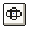
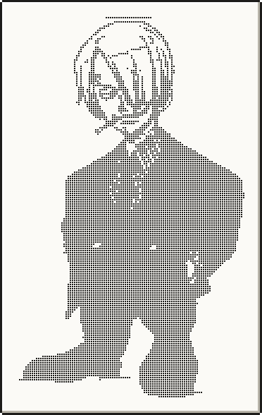

<p></p>

```text
 .-----------------------------------------------------------------------------.
 | (x) (-) (+)                     ~/about.txt                                 |
 |-----------------------------------------------------------------------------|
 |                                                                             |
 | PT  Dev full-stack em Itajaí/SC, há mais de 2 anos com APIs REST,           |
 |     microsserviços, web e apps React Native. Hoje na KTI Technology;        |
 |     antes Yellowling Traduções e IntuitiveCare.                             |
 |     Ciência da Computação na Univali, formatura prevista para 2027.         |
 |                                                                             |
 | EN  Full-stack developer from Itajaí, Brazil, with 2+ years building        |
 |     REST APIs, microservices, web and React Native apps. Currently at       |
 |     KTI Technology; previously Yellowling Traduções and IntuitiveCare.      |
 |     Computer Science at Univali, graduating in 2027.                        |
 | -@JordanLippert                                                             |
 |                                                                             |
 '-----------------------------------------------------------------------------'
```

<p></p>

<p>
  
</p>

<p>
  
</p>

<p>
  
</p>

<p>
  
</p>

<p></p>

<ul>
  <li><b><a href="https://pracompra.vercel.app">Pracomprá</a></b> · Expo, TypeScript, C#/.NET 8<br>Lista de compras em PWA instalável, com uso offline, seleção por voz e envio pelo WhatsApp.<br>Shopping list as an installable PWA, with offline use, voice selection and WhatsApp sharing.</li>
  <li><b><a href="https://github.com/JordanLippert/devroast">DevRoast</a></b> · Next.js, TypeScript, Drizzle, PostgreSQL, Gemini<br>Cole seu código e receba nota, feedback e sugestões geradas por IA, com leaderboard público.<br>Paste your code and get an AI score, feedback and suggestions, with a public leaderboard.</li>
</ul>

<p></p>

<p>
  <a href="https://www.linkedin.com/in/jordan-lippert-de-oliveira/"></a
  ><a href="https://github.com/JordanLippert"></a
  ><a href="mailto:lippertx11@gmail.com"></a>
</p>

<p align="center"></p>

```text
 jordan@github ~ % exit
 logout
 Saving session...completed.

 [Process completed]▌
```
